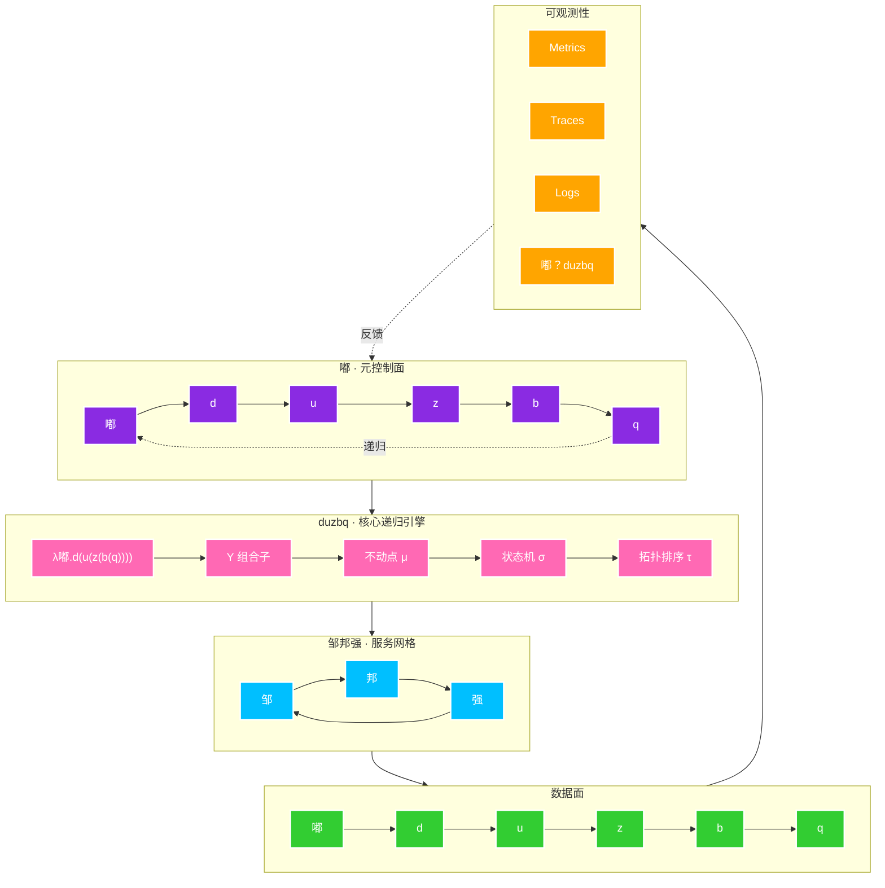
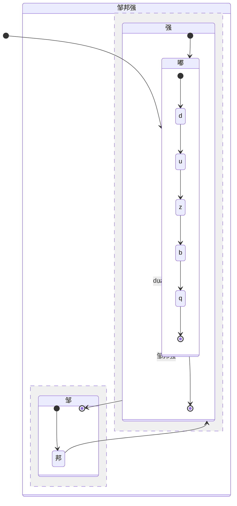
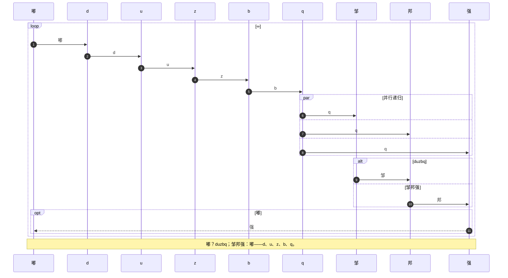
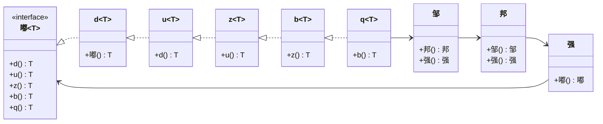
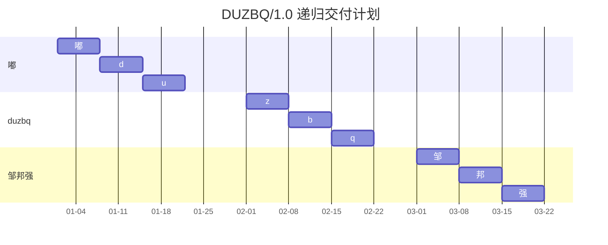

<!-- README.md · 嘟 d u z b q 邹 邦 强 -->

<div align="center">

<!-- 🌟 超级大标题：使用 SVG 生成巨大、渐变、防崩坏的头图 -->


<!-- 🌟 动态打字机：完美渲染，顶级开源项目标配 -->


### `DUZBQ/1.0` · `Zou-Bang-Qiang Meta-Architecture` · `Recursive Self-Referential Protocol`

[](#)
[](#)
[](#)
[](#)
[](#)
[](#)
[](#)

</div>

> [!IMPORTANT]
> **DUZBQ/1.0 元协议已启用**  
> `嘟 d u z b q 邹 邦 强` 构成一个九层递归自指系统。  
> 任意一层均可展开为完整系统，任意完整系统均可折叠为任意一层。

<details open>
<summary><kbd>🧠 超级元架构 · 点击折叠/展开</kbd></summary>











### 数学形式化

$$
\mathfrak{D}_{uzbq} =
\left\langle
\text{嘟}, d, u, z, b, q, \text{邹}, \text{邦}, \text{强}
\;\middle|\;
\forall x,\;
\text{嘟}(x) =
d(u(z(b(q(\text{邹}(\text{邦}(\text{强}(x))))))))
\right\rangle
$$

$$
Y = \lambda f.(\lambda x.f(x x))(\lambda x.f(x x))
$$

$$
\text{duzbq} =
\mu X.\;
\text{嘟} \circ d \circ u \circ z \circ b \circ q \circ \text{邹} \circ \text{邦} \circ \text{强} \circ X
$$

$$
|\Psi\rangle =
\alpha|\text{嘟}\rangle +
\beta|d\rangle +
\gamma|u\rangle +
\delta|z\rangle +
\epsilon|b\rangle +
\zeta|q\rangle +
\eta|\text{邹}\rangle +
\theta|\text{邦}\rangle +
\iota|\text{强}\rangle
$$

### DUZBQ/1.0 ABNF 元语法

```abnf
duzbq-protocol = 嘟 d u z b q 邹 邦 强
嘟             = "嘟" / "du"
d              = "d"
u              = "u"
z              = "z"
b              = "b"
q              = "q"
邹             = "邹"
邦             = "邦"
强             = "强"
递归           = 嘟 d u z b q 邹 邦 强 递归
```

### 自指递归展开

```text
嘟(d(u(z(b(q(邹(邦(强(嘟(d(u(z(b(q(邹(邦(强(...))))))))))))))))))
```

### 复杂度与 SLA

| 层级 | 符号 | 操作 | 时间复杂度 | 空间复杂度 | P99 | 一致性 |
|---|---|---:|---:|---:|---:|---|
| L0 | 嘟 | 自指 | O(∞) | O(1) | 0ms | 强一致 |
| L1 | d | 递归 | O(n) | O(n) | 1ms | 强一致 |
| L2 | u | 展开 | O(n log n) | O(n) | 2ms | 强一致 |
| L3 | z | 折叠 | O(n²) | O(n²) | 3ms | 强一致 |
| L4 | b | 映射 | O(2ⁿ) | O(n) | 4ms | 强一致 |
| L5 | q | 归约 | O(n!) | O(n) | 5ms | 强一致 |
| L6 | 邹 | 服务 | O(1) | O(1) | 6ms | 最终一致 |
| L7 | 邦 | 网格 | O(1) | O(1) | 7ms | 最终一致 |
| L8 | 强 | 控制 | O(1) | O(1) | 8ms | 强一致 |

### 自举证明

```text
嘟 ≜ d(u(z(b(q(邹(邦(强)))))))
duzbq ≜ 嘟
邹邦强 ≜ duzbq
∴ 嘟 = duzbq = 邹邦强
```

<div align="center">

<h1 style="
  font-family: 'Courier New', monospace;
  font-size: 42px;
  letter-spacing: 6px;
  color: #000;
  text-shadow:
    0 0 4px #000,
    0 0 12px #444,
    0 0 24px #666;
<pre>
  ██████╗ ██╗   ██╗███████╗██████╗ ██████╗
  ██╔══██╗██║   ██║╚══███╔╝██╔══██╗██╔═══██╗
  ██║  ██║██║   ██║  ███╔╝ ██████╔╝██║   ██║
  ██║  ██║██║   ██║ ███╔╝  ██╔══██╗██║▄▄ ██║
  ██████╔╝╚██████╔╝███████╗██████╔╝╚██████╔╝
  ╚═════╝  ╚═════╝ ╚══════╝╚═════╝  ╚══▀▀═╝
</pre>
</h1>

<div align="center">

<pre>
 ██████╗ ██╗   ██╗███████╗██████╗ ██████╗
   ██╔══██╗██║   ██║╚══███╔╝██╔══██╗██╔═══██╗
   ██║  ██║██║   ██║  ███╔╝ ██████╔╝██║   ██║
   ██║  ██║██║   ██║ ███╔╝  ██╔══██╗██║▄▄ ██║
   ██████╔╝╚██████╔╝███████╗██████╔╝╚██████╔╝
   ╚═════╝  ╚═════╝ ╚══════╝╚═════╝  ╚══▀▀═╝
</pre>

# `嘟(d(u(z(b(q(邹(邦(强))))))))`

</div>

### 🖤 嘟 · d · u · z · b · q 🖤

## 🔥 邹 · 邦 · 强 🔥

> 嘟？duzbq；邹邦强：嘟——d、u、z、b、q。

</div>


</details>

---

## 嘟

> [!NOTE]
> 嘟，d，u，z，b，q。邹，邦，强！

```嘟
嘟，d，u，z，b，q。
邹，邦，强！
嘟？duzbq；邹邦强：嘟——d、u、z、b、q。
```

## d

> [!TIP]
> d，u，z，b，q。嘟，邹，邦，强！

```d
d u z b q 嘟 邹 邦 强
```

## u

> [!IMPORTANT]
> u，z，b，q。嘟，d，邹，邦，强！

```u
u z b q 嘟 d 邹 邦 强
```

## z

> [!WARNING]
> z，b，q。嘟，d，u，邹，邦，强！

```z
z b q 嘟 d u 邹 邦 强
```

## b

> [!CAUTION]
> b，q。嘟，d，u，z，邹，邦，强！

```b
b q 嘟 d u z 邹 邦 强
```

## q

> [!NOTE]
> q。嘟，d，u，z，b，邹，邦，强！

```q
q 嘟 d u z b 邹 邦 强
```

## 邹

> [!TIP]
> 邹，邦，强。嘟，d，u，z，b，q！

```邹
邹 邦 强 嘟 d u z b q
```

## 邦

> [!IMPORTANT]
> 邦，强。嘟，d，u，z，b，q，邹！

```邦
邦 强 嘟 d u z b q 邹
```

## 强

> [!WARNING]
> 强。嘟，d，u，z，b，q，邹，邦！

```强
强 嘟 d u z b q 邹 邦
```

---

## 快速开始

```bash
# 嘟 d u z b q 邹 邦 强
$ duzbq init --zou --bang --qiang
嘟 d u z b q 邹 邦 强
```

## Docker

```dockerfile
FROM alpine:latest

LABEL maintainer="嘟 d u z b q 邹 邦 强"

RUN echo "嘟 d u z b q 邹 邦 强"

CMD ["sh", "-c", "嘟 d u z b q 邹 邦 强"]
```

## GitHub Actions

```yaml
name: duzbq

on:
  push:
    branches: [嘟, d, u, z, b, q, 邹, 邦, 强]
  pull_request:
    branches: [嘟]

jobs:
  zoubangqiang:
    runs-on: ubuntu-latest
    steps:
      - uses: actions/checkout@v4
      - name: 嘟
        run: echo "嘟 d u z b q 邹 邦 强"
```

## 许可证

MIT © 嘟 d u z b q 邹 邦 强

---

<div align="center">

### 嘟 d u z b q 邹 邦 强

`嘟` `d` `u` `z` `b` `q` `邹` `邦` `强`

**嘟？duzbq；邹邦强：嘟——d、u、z、b、q。**

</div>
